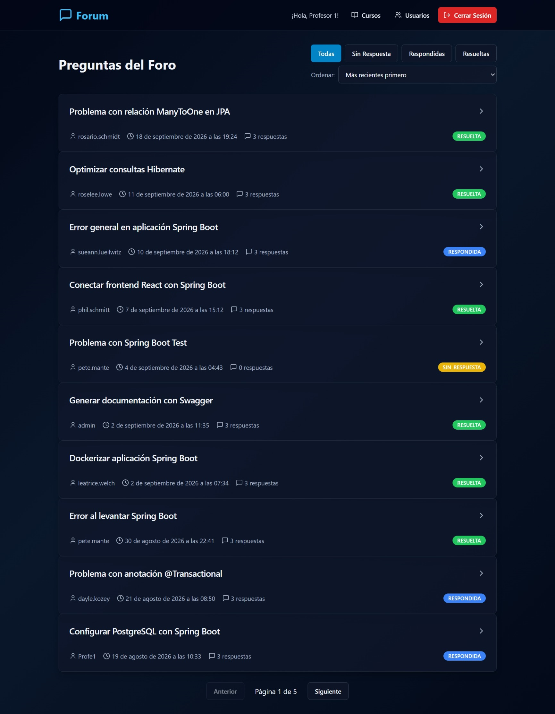
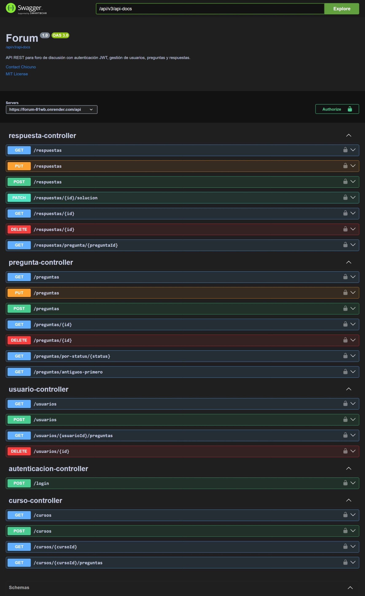

<h1 align="center">Forum</h1>

<p align=center>
  
  
  
  
  
</p>

<br>

<h3>API REST para foro de discusión con autenticación JWT, gestión de usuarios, preguntas y respuestas. Incluye frontend desplegado para demostración.</h3>

<br>

El frontend permite las peticiones HTTP básicas para demostración. Por medio de Swagger puedes acceder a todas las peticiones HTTP.

La aplicación cuenta con un perfil `demo` que activa un `DataSeeder` automático para poblar la base de datos con 10 cursos, 3 usuarios predeterminados, 20 usuarios simulados generados con Datafaker, 50 preguntas y 120 respuestas creadas con IA. Solo se ejecuta si la base de datos está vacía.

Puedes iniciar sesión con `admin / 123456`, `Profe1 / 123456` o cualquiera de los usuarios (puedes verlos una vez que entres a la aplicación) con la misma contraseña.

## Pruébala aquí:

**Demo:** https://forum-81wb.onrender.com

**Swagger:** https://forum-81wb.onrender.com/api/swagger-ui/index.html

<br>

| Página principal demo | Interfaz Swagger |
|---|---|
|  |  |

<br>

## Sobre el proyecto

Forum es un reto de mis profesores para poner en práctica la mayor parte de lo aprendido en mi formación Back-end en [Alura Latam](https://www.aluracursos.com/) dentro del proyecto [ONE](https://www.oracle.com/latam/education/oracle-next-education/) el cual he ido corrigiendo y mejorando buscando que sea una aplicación sin errores y más completa.

**Repositorio:** https://github.com/Chicuno/forum

<br>

## Funcionalidades

- Inicio de sesión con JWT.
- Autorización por roles con Spring Security.
- Gestión de usuarios y cursos.
- Creación, consulta, edición y eliminación de preguntas.
- Creación, consulta, edición y eliminación de respuestas.
- Paginación y ordenamiento de preguntas y respuestas.
- Marcado de una respuesta como solución y una pregunta como solucionada en una sola transacción.
- Frontend desplegado para demostración.
- Documentación interactiva de la API con Swagger UI.
- Datos de demostración generados automáticamente con el perfil `demo`.
- Manejo de errores para devolver mensajes claros al usuario.

<br>

## Autenticación y autorización

**Autenticación:** el usuario se identifica con nombre de usuario y contraseña.
El backend valida las credenciales contra la base de datos (contraseñas con BCrypt)
y devuelve un JWT firmado con HS256, con expiración de 2 horas.

**Autorización:** cada petición pasa por un filtro de Spring Security que valida
el JWT y comprueba el rol del usuario contra las reglas de `SecurityConfigurations.java`.
Los roles son ADMINISTRADOR, PROFESOR y ALUMNO.

<br>

Administradores y profesores pueden gestionar preguntas y respuestas; los alumnos pueden editar o eliminar las que ellos mismos crearon. El autor de una pregunta también puede marcar una respuesta como solución.

Detalle de autorización otorgada a los roles o condición de propietario:

| Acción a realizar | ¿Quién puede hacerlo? |
|---|---|
| Iniciar sesión | Público |
| Crear usuario | ADMINISTRADOR |
| Listar usuarios | ADMINISTRADOR, PROFESOR, ALUMNO |
| Borrar usuario | ADMINISTRADOR |
| Crear curso | ADMINISTRADOR, PROFESOR |
| Listar cursos | ADMINISTRADOR, PROFESOR, ALUMNO |
| Detallar curso | ADMINISTRADOR, PROFESOR, ALUMNO |
| Crear pregunta | ADMINISTRADOR, PROFESOR, ALUMNO |
| Listar preguntas | ADMINISTRADOR, PROFESOR, ALUMNO |
| Detallar pregunta | ADMINISTRADOR, PROFESOR, ALUMNO |
| Listar respuestas de una pregunta | ADMINISTRADOR, PROFESOR, ALUMNO |
| Marcar pregunta como SPAM | ADMINISTRADOR, PROFESOR |
| Actualizar pregunta | ADMINISTRADOR, PROFESOR, Autor de la pregunta |
| Borrar pregunta | ADMINISTRADOR, PROFESOR, Autor de la pregunta |
| Crear respuesta | ADMINISTRADOR, PROFESOR, ALUMNO |
| Listar respuestas | ADMINISTRADOR, PROFESOR, ALUMNO |
| Detallar respuesta | ADMINISTRADOR, PROFESOR, ALUMNO |
| Marcar respuesta como solución | ADMINISTRADOR, PROFESOR, Autor de la pregunta |
| Editar respuesta | ADMINISTRADOR, PROFESOR, Autor de la respuesta |
| Borrar respuesta | ADMINISTRADOR, PROFESOR, Autor de la respuesta |
| Swagger / OpenAPI | Público |

> Al marcar una respuesta como solución, la pregunta asociada se actualiza
> automáticamente a estado `RESUELTA` en la misma transacción. No existe un
> endpoint independiente para marcar la pregunta como solucionada.

<br>

## Ejecutar la demo localmente con Docker

### Requisitos

- **Obligatorio:** Docker Engine 20.10+ y Docker Compose v2
- **Opcional:** Git (solo si clonas el repo; también puedes descargar el ZIP)
- **No necesario:** Java, Maven, Node ni PostgreSQL (todo va dentro de Docker)

> En Windows y macOS, Docker Desktop ya incluye Docker Engine y Compose.
> En Linux, instala el plugin `docker-compose-plugin` de tu distribución.

### 1. Obtén el código

**Opción A — con Git (recomendado si vas a contribuir):**

**Bash:**
```bash
git clone https://github.com/Chicuno/forum.git
cd forum
```

**Opción B — sin Git (descarga ZIP):**

1. Ve a https://github.com/Chicuno/forum
2. Pulsa **Code → Download ZIP**
3. Descomprime el archivo
4. Abre una terminal en esa carpeta:
   - **Windows 11:** clic derecho en la carpeta → "Abrir en Terminal"
   - **Windows 10:** Shift + clic derecho → "Abrir ventana de PowerShell aquí"
   - **macOS/Linux:** abre la terminal y usa `cd` hasta la carpeta

### 2. Configura el entorno

Crea tu archivo `.env` a partir del ejemplo:

**Bash:**
```bash
cp .env.example .env
```

**PowerShell:**
```powershell
Copy-Item .env.example .env
```

Una vez creado el archivo `.env` puedes editarlo y establecer valores propios para `POSTGRES_PASSWORD` y `JWT_SECRET`.

### 3. Levanta la app

**Bash / PowerShell:**
```bash
docker compose up --build
```

La primera vez tarda unos minutos porque descarga imágenes y compila frontend + backend. Las siguientes veces es mucho más rápido.

Abre `http://localhost:8080`. La API se expone a través del mismo origen que el frontend. Swagger está disponible en `http://localhost:8080/api/swagger-ui/index.html`.

### 4. Inicia sesión

El perfil `demo` crea datos de muestra solamente en una base nueva. Puedes iniciar sesión con `admin / 123456`, `Profe1 / 123456` o cualquiera de los usuarios para probar sus permisos (puedes verlos una vez que entres a la aplicación, Datafaker los crea) con la misma contraseña `123456`.

### Reiniciar los datos de demostración

Si quieres volver al estado inicial (borra la base de datos local y vuelve a poblarla con nuevos usuarios):

**Bash / PowerShell:**
```bash
docker compose down -v
docker compose up --build
```

> `-v` elimina el volumen de PostgreSQL. Úsalo solo si quieres empezar de cero.

<br>

## Tecnologías utilizadas

**Backend:** Java 17 · Spring Boot 3.3 · Spring Security · Spring Data JPA · Hibernate · Flyway · PostgreSQL · Maven · Springdoc OpenAPI · Lombok · java-jwt · Datafaker

**Frontend:** React 18 · Vite 5 · React Router 6 · Axios · Tailwind CSS · Lucide React

**Infraestructura:** Docker multi-stage · nginx · Docker Compose · Render · Neon (PostgreSQL gestionado)

<br>

## Arquitectura

En producción, frontend y backend se empaquetan en un **único contenedor** con nginx como reverse proxy:

- nginx sirve el SPA en `/`.
- nginx reenvía `/api/*` a Spring Boot en `127.0.0.1:8080`.
- La base de datos es PostgreSQL gestionado en Neon, accesible por `DB_URL`.

En local, `docker compose` levanta además un contenedor PostgreSQL, de modo que no necesitas instalar nada más que Docker.

<br>

## Estructura del proyecto

```
forum/
├── src/                # Backend Spring Boot
├── frontend/           # Aplicación web React + Vite
├── images/             # Imágenes usadas en la documentación
├── Dockerfile          # Imagen unificada (frontend + backend + nginx)
├── entrypoint.sh       # Arranca Spring Boot y nginx
├── nginx.conf.template # Config de nginx (proxy /api → Spring Boot)
└── compose.yaml        # BD local + app para desarrollo
```

**Backend (organizado en capas):**

```
src/main/java/com/fernandez/foro_hub/
├── config/         # DataSeeder (puebla la BD con el perfil demo)
├── controller/     # Endpoints REST
├── domain/         # Entidades JPA, DTOs, repositorios y servicios, por dominio
│   ├── curso/
│   ├── pregunta/
│   ├── respuesta/
│   └── usuario/
└── infra/          # Infraestructura transversal
    ├── exceptions/ # Manejo global de excepciones
    ├── security/   # Configuración de Spring Security, JWT y filtros
    └── springdoc/  # Configuración de OpenAPI / Swagger
```

**Recursos:**

```
src/main/resources/
├── application.properties       # Configuración común
├── application-demo.properties  # Perfil demo (activa el DataSeeder)
└── db/migration/                # Migraciones Flyway
```

**Frontend:**

```
frontend/src/
├── pages/         # Vistas por ruta (Login, Home, PreguntaDetail, Cursos, ...)
├── components/    # Componentes reutilizables
│   ├── ui/        # Componentes base (Button, Card, Input, Select, Textarea, Badge)
│   └── Layout.jsx # Layout común de la aplicación
├── context/       # AuthContext (estado de sesión y JWT)
├── lib/           # Utilidades (utils.js)
├── services/      # Cliente Axios y endpoints por dominio (api.js)
├── App.jsx        # Rutas y composición de la aplicación
├── main.jsx       # Punto de entrada de React
└── index.css      # Estilos globales (Tailwind)
```
---

## Licencia

Forum tiene Licencia MIT tal como se indica en el archivo [LICENSE](LICENSE).
